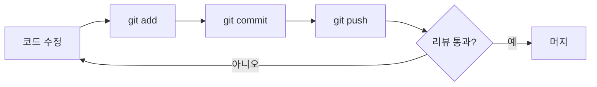
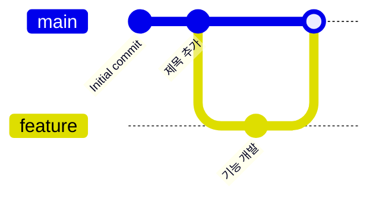
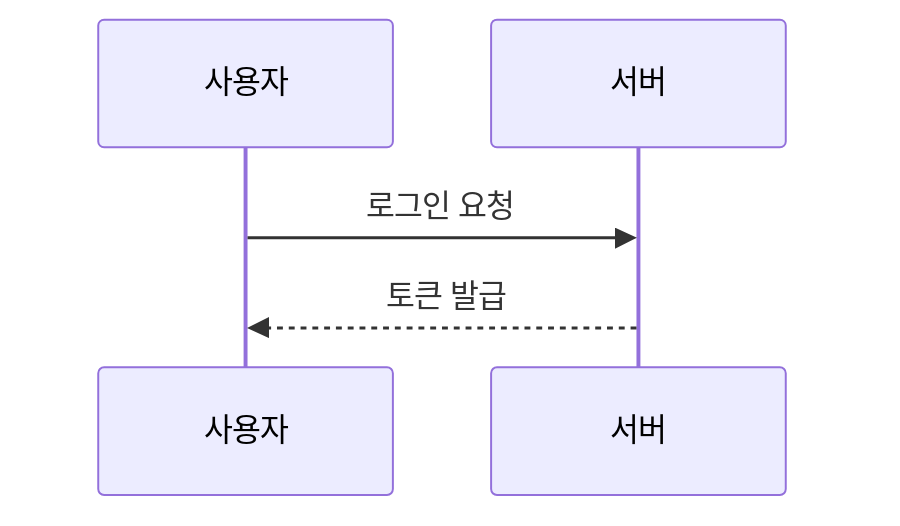

# gitexercise
git exercise sample

---

# 📘 마크다운(Markdown) 문법 완벽 가이드

> 이 문서는 GitHub에서 사용하는 **GitHub Flavored Markdown(GFM)** 기준으로 작성되었습니다.
> 각 항목마다 **작성법(코드)** 과 **결과(렌더링)** 를 함께 보여줍니다.

## 📑 목차

1. [제목 (Headings)](#1-제목-headings)
2. [문단과 줄바꿈](#2-문단과-줄바꿈)
3. [텍스트 강조](#3-텍스트-강조)
4. [인용문 (Blockquote)](#4-인용문-blockquote)
5. [목록 (Lists)](#5-목록-lists)
6. [체크리스트 (Task List)](#6-체크리스트-task-list)
7. [코드 (Code)](#7-코드-code)
8. [링크 (Links)](#8-링크-links)
9. [이미지 (Images)](#9-이미지-images)
10. [표 (Tables)](#10-표-tables)
11. [수평선 (Horizontal Rule)](#11-수평선-horizontal-rule)
12. [이스케이프 문자](#12-이스케이프-문자)
13. [각주 (Footnotes)](#13-각주-footnotes)
14. [접기/펼치기 (details)](#14-접기펼치기-details)
15. [알림 박스 (Alerts)](#15-알림-박스-alerts)
16. [이모지 (Emoji)](#16-이모지-emoji)
17. [수식 (Math)](#17-수식-math)
18. [다이어그램 (Mermaid)](#18-다이어그램-mermaid)
19. [HTML 태그 사용](#19-html-태그-사용)
20. [주석 (Comments)](#20-주석-comments)
21. [GitHub 전용 기능](#21-github-전용-기능)

---

## 1. 제목 (Headings)

`#` 기호의 개수로 제목의 크기(1~6단계)를 정합니다. `#` 뒤에는 **반드시 공백**을 넣어야 합니다.

**작성법**

```markdown
# 제목 1 (H1)
## 제목 2 (H2)
### 제목 3 (H3)
#### 제목 4 (H4)
##### 제목 5 (H5)
###### 제목 6 (H6)
```

**결과**

# 제목 1 (H1)
## 제목 2 (H2)
### 제목 3 (H3)
#### 제목 4 (H4)
##### 제목 5 (H5)
###### 제목 6 (H6)

### 대체 문법 (Setext 방식)

H1과 H2는 텍스트 아래에 `=` 또는 `-`를 써서 만들 수도 있습니다.

```markdown
제목 1
======

제목 2
------
```

> 💡 **팁:** 문서에는 보통 H1을 하나만 사용하고, 그 아래로 H2, H3 순서로 구조를 잡는 것이 좋습니다.

---

## 2. 문단과 줄바꿈

### 문단 나누기

빈 줄(엔터 두 번)을 넣으면 새로운 문단이 됩니다.

```markdown
첫 번째 문단입니다.

두 번째 문단입니다.
```

### 줄바꿈

그냥 엔터 한 번만 치면 줄바꿈이 **적용되지 않습니다.** 줄바꿈을 하려면 아래 방법 중 하나를 사용하세요.

| 방법 | 작성법 |
|------|--------|
| 줄 끝에 공백 2칸 | `첫 줄␣␣` (␣ = 공백) |
| 줄 끝에 역슬래시 | `첫 줄\` |
| HTML 태그 | `첫 줄<br>` |

**작성법**

```markdown
첫 번째 줄<br>
두 번째 줄
```

**결과**

첫 번째 줄<br>
두 번째 줄

---

## 3. 텍스트 강조

| 스타일 | 작성법 | 결과 |
|--------|--------|------|
| 굵게 | `**굵게**` 또는 `__굵게__` | **굵게** |
| 기울임 | `*기울임*` 또는 `_기울임_` | *기울임* |
| 굵게 + 기울임 | `***굵게 기울임***` | ***굵게 기울임*** |
| 취소선 | `~~취소선~~` | ~~취소선~~ |
| 인라인 코드 | `` `코드` `` | `코드` |
| 아래 첨자 | `H<sub>2</sub>O` | H<sub>2</sub>O |
| 위 첨자 | `x<sup>2</sup>` | x<sup>2</sup> |
| 밑줄 (HTML) | `<ins>밑줄</ins>` | <ins>밑줄</ins> |
| 형광펜 (HTML) | `<mark>형광펜</mark>` | <mark>형광펜</mark> |
| 키보드 키 | `<kbd>Ctrl</kbd> + <kbd>C</kbd>` | <kbd>Ctrl</kbd> + <kbd>C</kbd> |

### 중첩 사용

```markdown
**굵은 글씨 안에 _기울임_ 을 넣을 수 있습니다.**
```

**굵은 글씨 안에 _기울임_ 을 넣을 수 있습니다.**

> ⚠️ **주의:** 단어 중간을 강조할 때는 `_` 대신 `*`를 사용하세요. (예: `가나*다*라` → 가나*다*라)

---

## 4. 인용문 (Blockquote)

줄 맨 앞에 `>`를 붙입니다.

**작성법**

```markdown
> 이것은 인용문입니다.
> 여러 줄로 이어서 쓸 수 있습니다.
>
> > 인용문 안에 인용문을 중첩할 수 있습니다.
> > > 세 번째 단계 중첩도 가능합니다.
>
> - 인용문 안에 **목록**이나
> - `코드` 같은 다른 문법도 사용 가능합니다.
```

**결과**

> 이것은 인용문입니다.
> 여러 줄로 이어서 쓸 수 있습니다.
>
> > 인용문 안에 인용문을 중첩할 수 있습니다.
> > > 세 번째 단계 중첩도 가능합니다.
>
> - 인용문 안에 **목록**이나
> - `코드` 같은 다른 문법도 사용 가능합니다.

---

## 5. 목록 (Lists)

### 5-1. 순서 없는 목록 (Unordered List)

`-`, `*`, `+` 중 하나를 사용합니다. 하위 목록은 **공백 2칸(또는 4칸)** 들여쓰기로 만듭니다.

**작성법**

```markdown
- 과일
  - 사과
  - 바나나
    - 노란 바나나
    - 초록 바나나
- 채소
  * 당근
  + 오이
```

**결과**

- 과일
  - 사과
  - 바나나
    - 노란 바나나
    - 초록 바나나
- 채소
  * 당근
  + 오이

### 5-2. 순서 있는 목록 (Ordered List)

숫자 뒤에 `.`을 붙입니다. 숫자를 모두 `1.`로 써도 자동으로 번호가 매겨집니다.

**작성법**

```markdown
1. 첫 번째
2. 두 번째
   1. 하위 항목 A
   2. 하위 항목 B
3. 세 번째

1. 모두 1로 써도
1. 자동으로
1. 번호가 매겨집니다
```

**결과**

1. 첫 번째
2. 두 번째
   1. 하위 항목 A
   2. 하위 항목 B
3. 세 번째

1. 모두 1로 써도
1. 자동으로
1. 번호가 매겨집니다

### 5-3. 시작 번호 지정

첫 번째 숫자가 시작 번호가 됩니다.

```markdown
5. 다섯 번째부터 시작
6. 여섯 번째
```

5. 다섯 번째부터 시작
6. 여섯 번째

### 5-4. 목록 안에 다른 요소 넣기

목록 항목 아래에 들여쓰기를 맞추면 문단, 코드 블록 등을 넣을 수 있습니다.

````markdown
1. 설치하기

   아래 명령어를 실행하세요.

   ```bash
   npm install
   ```

2. 실행하기
````

**결과**

1. 설치하기

   아래 명령어를 실행하세요.

   ```bash
   npm install
   ```

2. 실행하기

---

## 6. 체크리스트 (Task List)

`- [ ]`는 미완료, `- [x]`는 완료 항목입니다.

**작성법**

```markdown
- [x] 저장소 만들기
- [x] 첫 커밋 하기
- [ ] README 작성하기
  - [x] 마크다운 문법 정리
  - [ ] 예제 추가
- [ ] 푸시하기
```

**결과**

- [x] 저장소 만들기
- [x] 첫 커밋 하기
- [ ] README 작성하기
  - [x] 마크다운 문법 정리
  - [ ] 예제 추가
- [ ] 푸시하기

---

## 7. 코드 (Code)

### 7-1. 인라인 코드

백틱(`` ` ``) 한 개로 감쌉니다.

```markdown
`git status` 명령어로 상태를 확인합니다.
```

`git status` 명령어로 상태를 확인합니다.

> 💡 코드 안에 백틱이 있다면 백틱 두 개로 감싸세요: ``` `` `백틱` `` ``` → `` `백틱` ``

### 7-2. 코드 블록

백틱 3개(```` ``` ````) 또는 물결표 3개(`~~~`)로 감쌉니다. 여는 기호 뒤에 **언어 이름**을 쓰면 문법 강조(Syntax Highlighting)가 적용됩니다.

**작성법**

````markdown
```python
def hello(name):
    print(f"Hello, {name}!")

hello("World")
```
````

**결과**

```python
def hello(name):
    print(f"Hello, {name}!")

hello("World")
```

### 7-3. 자주 쓰는 언어 이름

| 언어 | 표기 | 언어 | 표기 |
|------|------|------|------|
| Python | `python` / `py` | JavaScript | `javascript` / `js` |
| TypeScript | `typescript` / `ts` | Java | `java` |
| C / C++ | `c` / `cpp` | C# | `csharp` / `cs` |
| HTML | `html` | CSS | `css` |
| JSON | `json` | YAML | `yaml` / `yml` |
| Bash | `bash` / `sh` | PowerShell | `powershell` / `ps1` |
| SQL | `sql` | Markdown | `markdown` / `md` |
| 변경사항 | `diff` | 일반 텍스트 | `text` / `plaintext` |

### 7-4. diff 표현

````markdown
```diff
- 삭제된 줄
+ 추가된 줄
  변경 없는 줄
```
````

```diff
- 삭제된 줄
+ 추가된 줄
  변경 없는 줄
```

### 7-5. 들여쓰기 코드 블록

공백 4칸(또는 탭)으로 들여쓰면 코드 블록이 됩니다. (언어 지정 불가)

```markdown
    이 줄은 코드 블록입니다.
```

    이 줄은 코드 블록입니다.

---

## 8. 링크 (Links)

### 8-1. 기본 링크

```markdown
[GitHub](https://github.com)
[GitHub](https://github.com "마우스를 올리면 보이는 제목")
```

[GitHub](https://github.com)<br>
[GitHub](https://github.com "마우스를 올리면 보이는 제목")

### 8-2. 자동 링크

```markdown
<https://www.google.com>
<example@email.com>
https://github.com  ← GitHub에서는 URL만 써도 자동 링크
```

<https://www.google.com>

### 8-3. 참조형 링크

링크 주소를 문서 아래쪽에 따로 모아둘 수 있습니다.

```markdown
[구글][1]과 [네이버][naver]에 방문하세요.

[1]: https://www.google.com
[naver]: https://www.naver.com
```

[구글][1]과 [네이버][naver]에 방문하세요.

[1]: https://www.google.com
[naver]: https://www.naver.com

### 8-4. 문서 내부 링크 (앵커)

제목으로 이동하는 링크입니다. 제목을 **소문자**로 바꾸고, **공백은 `-`** 으로, **특수문자는 제거**합니다.

```markdown
[목차로 이동](#-목차)
[제목 섹션으로 이동](#1-제목-headings)
```

[목차로 이동](#-목차)

### 8-5. 상대 경로 링크

같은 저장소 안의 파일로 연결합니다.

```markdown
[test.py 파일 보기](test.py)
[상위 폴더의 파일](../other/file.md)
```

[test.py 파일 보기](test.py)

---

## 9. 이미지 (Images)

링크 문법 앞에 `!`를 붙입니다. `[ ]` 안에는 **대체 텍스트(alt)** 를 씁니다.

### 9-1. 기본 이미지

```markdown


```


### 9-2. 크기 조절 (HTML 사용)

마크다운 자체로는 크기 조절이 안 되므로 HTML `` 태그를 사용합니다.

```html

```

### 9-3. 이미지에 링크 걸기

```markdown
[](이동할_링크)
```

### 9-4. 가운데 정렬

```html
<p align="center">
  
</p>
```

### 9-5. 배지 (Badge)

[shields.io](https://shields.io)를 이용해 배지를 만들 수 있습니다.

```markdown


```


---

## 10. 표 (Tables)

`|`로 열을 나누고, 두 번째 줄에 `---`로 헤더 구분선을 만듭니다.

### 10-1. 기본 표

```markdown
| 이름 | 나이 | 직업 |
|------|------|------|
| 철수 | 25 | 개발자 |
| 영희 | 30 | 디자이너 |
```

| 이름 | 나이 | 직업 |
|------|------|------|
| 철수 | 25 | 개발자 |
| 영희 | 30 | 디자이너 |

### 10-2. 정렬

구분선에 `:`를 붙여 정렬합니다.

| 문법 | 정렬 |
|------|------|
| `:---` | 왼쪽 정렬 |
| `:---:` | 가운데 정렬 |
| `---:` | 오른쪽 정렬 |

```markdown
| 왼쪽 | 가운데 | 오른쪽 |
|:-----|:------:|-------:|
| A | B | C |
| 가나다라 | 마바사 | 1,000 |
```

| 왼쪽 | 가운데 | 오른쪽 |
|:-----|:------:|-------:|
| A | B | C |
| 가나다라 | 마바사 | 1,000 |

### 10-3. 표 안에서 사용 가능한 것

- 강조: `**굵게**`, `*기울임*`, `~~취소선~~`
- 인라인 코드, 링크, 이미지
- 줄바꿈: `<br>`
- `|` 문자 자체를 쓰려면 `\|`로 이스케이프

```markdown
| 항목 | 설명 |
|------|------|
| **굵게** | 첫 줄<br>둘째 줄 |
| `a \| b` | 파이프 문자 포함 |
```

| 항목 | 설명 |
|------|------|
| **굵게** | 첫 줄<br>둘째 줄 |
| `a \| b` | 파이프 문자 포함 |

---

## 11. 수평선 (Horizontal Rule)

아래 세 가지 중 하나를 **3개 이상** 연속으로 씁니다.

```markdown
---
***
___
```

---

> ⚠️ **주의:** 텍스트 바로 아래 줄에 `---`를 쓰면 H2 제목(Setext)으로 인식됩니다. 반드시 위에 **빈 줄**을 넣으세요.

---

## 12. 이스케이프 문자

마크다운 기호를 문자 그대로 표시하려면 앞에 역슬래시(`\`)를 붙입니다.

```markdown
\*별표가 그대로 보입니다\*
\# 제목이 아닙니다
\[대괄호\]
```

\*별표가 그대로 보입니다\*<br>
\# 제목이 아닙니다<br>
\[대괄호\]

**이스케이프 가능한 문자 목록**

```text
\   역슬래시        `   백틱           *   별표
_   밑줄            { } 중괄호         [ ] 대괄호
( ) 소괄호          #   샵             +   더하기
-   빼기            .   마침표         !   느낌표
|   파이프          <   >  꺾쇠괄호
```

---

## 13. 각주 (Footnotes)

본문에 `[^이름]`을 쓰고, 아래에 `[^이름]: 내용`을 작성합니다. 각주는 문서 맨 아래에 자동으로 모입니다.

```markdown
마크다운은 존 그루버가 만들었습니다.[^1]
GFM은 GitHub의 확장 문법입니다.[^gfm]

[^1]: 2004년에 처음 발표되었습니다.
[^gfm]: GitHub Flavored Markdown의 약자입니다.
```

마크다운은 존 그루버가 만들었습니다.[^1]
GFM은 GitHub의 확장 문법입니다.[^gfm]

[^1]: 2004년에 처음 발표되었습니다.
[^gfm]: GitHub Flavored Markdown의 약자입니다.

---

## 14. 접기/펼치기 (details)

HTML의 `<details>`와 `<summary>` 태그를 사용합니다. `<summary>` 다음에 **빈 줄**을 넣어야 안쪽 마크다운이 정상 렌더링됩니다.

````markdown
<details>
<summary>👉 클릭해서 펼치기</summary>

숨겨진 내용입니다. **마크다운**도 사용할 수 있습니다.

```python
print("숨겨진 코드")
```

</details>
````

<details>
<summary>👉 클릭해서 펼치기</summary>

숨겨진 내용입니다. **마크다운**도 사용할 수 있습니다.

```python
print("숨겨진 코드")
```

</details>

> 💡 처음부터 펼쳐진 상태로 두려면 `<details open>`을 사용하세요.

---

## 15. 알림 박스 (Alerts)

GitHub 전용 문법으로, 인용문 첫 줄에 `[!종류]`를 씁니다.

```markdown
> [!NOTE]
> 참고할 만한 정보입니다.

> [!TIP]
> 더 잘 사용하기 위한 팁입니다.

> [!IMPORTANT]
> 꼭 알아야 할 중요한 정보입니다.

> [!WARNING]
> 주의가 필요한 내용입니다.

> [!CAUTION]
> 위험하거나 부정적인 결과를 초래할 수 있는 내용입니다.
```

> [!NOTE]
> 참고할 만한 정보입니다.

> [!TIP]
> 더 잘 사용하기 위한 팁입니다.

> [!IMPORTANT]
> 꼭 알아야 할 중요한 정보입니다.

> [!WARNING]
> 주의가 필요한 내용입니다.

> [!CAUTION]
> 위험하거나 부정적인 결과를 초래할 수 있는 내용입니다.

---

## 16. 이모지 (Emoji)

### 16-1. 단축 코드

GitHub에서는 `:이름:` 형식의 단축 코드를 지원합니다.

| 작성법 | 결과 | 작성법 | 결과 |
|--------|------|--------|------|
| `:smile:` | :smile: | `:heart:` | :heart: |
| `:+1:` | :+1: | `:rocket:` | :rocket: |
| `:fire:` | :fire: | `:star:` | :star: |
| `:bug:` | :bug: | `:sparkles:` | :sparkles: |
| `:memo:` | :memo: | `:white_check_mark:` | :white_check_mark: |
| `:warning:` | :warning: | `:tada:` | :tada: |

### 16-2. 유니코드 이모지

이모지를 직접 입력해도 됩니다. (Windows: <kbd>Win</kbd> + <kbd>.</kbd>)

```markdown
🚀 배포 완료! 🎉
```

🚀 배포 완료! 🎉

---

## 17. 수식 (Math)

GitHub는 LaTeX 문법의 수식(MathJax)을 지원합니다.

### 17-1. 인라인 수식

`$...$` 로 감쌉니다.

```markdown
피타고라스 정리는 $a^2 + b^2 = c^2$ 입니다.
```

피타고라스 정리는 $a^2 + b^2 = c^2$ 입니다.

### 17-2. 블록 수식

`$$...$$` 로 감쌉니다.

```markdown
$$
x = \frac{-b \pm \sqrt{b^2 - 4ac}}{2a}
$$
```

$$
x = \frac{-b \pm \sqrt{b^2 - 4ac}}{2a}
$$

### 17-3. 자주 쓰는 수식 기호

| 표현 | LaTeX | 표현 | LaTeX |
|------|-------|------|-------|
| 분수 | `\frac{a}{b}` | 제곱근 | `\sqrt{x}` |
| 위 첨자 | `x^2` | 아래 첨자 | `x_i` |
| 합 | `\sum_{i=1}^{n}` | 적분 | `\int_a^b` |
| 그리스 문자 | `\alpha, \beta, \pi` | 무한대 | `\infty` |

---

## 18. 다이어그램 (Mermaid)

코드 블록 언어를 `mermaid`로 지정하면 GitHub에서 다이어그램으로 렌더링됩니다.

### 18-1. 플로우차트

````markdown

````


### 18-2. Git 그래프

````markdown

````


### 18-3. 시퀀스 다이어그램



---

## 19. HTML 태그 사용

마크다운 안에서 대부분의 HTML 태그를 사용할 수 있습니다. (GitHub는 `<script>`, `<style>`, `style` 속성 등은 보안상 제거합니다.)

| 용도 | 작성법 |
|------|--------|
| 줄바꿈 | `<br>` |
| 가운데 정렬 | `<p align="center">텍스트</p>` |
| 이미지 크기 | `` |
| 접기 | `<details><summary>제목</summary>내용</details>` |
| 키보드 | `<kbd>Enter</kbd>` |
| 위/아래 첨자 | `<sup>위</sup>`, `<sub>아래</sub>` |
| 앵커 지정 | `<a name="my-anchor"></a>` |

```html
<p align="center">
  <b>가운데 정렬된 굵은 글씨</b>
</p>
```

<p align="center">
  <b>가운데 정렬된 굵은 글씨</b>
</p>

---

## 20. 주석 (Comments)

렌더링 결과에 보이지 않는 주석을 남길 수 있습니다.

```markdown
<!-- 이 내용은 화면에 보이지 않습니다 -->
```

<!-- 이 내용은 화면에 보이지 않습니다 -->

(위에 주석이 있지만 보이지 않습니다 👆)

---

## 21. GitHub 전용 기능

GitHub의 Issue, Pull Request, 커밋 메시지, 댓글 등에서 사용할 수 있는 기능입니다.

| 기능 | 작성법 | 설명 |
|------|--------|------|
| 사용자 멘션 | `@username` | 해당 사용자에게 알림 |
| 팀 멘션 | `@org/team-name` | 팀 전체에 알림 |
| 이슈/PR 참조 | `#123` | 123번 이슈/PR로 링크 |
| 다른 저장소 이슈 | `owner/repo#123` | 다른 저장소의 이슈 링크 |
| 커밋 참조 | `1b634fc` | 커밋 SHA로 자동 링크 |
| 이슈 자동 닫기 | `Closes #123`, `Fixes #123` | PR 머지 시 이슈 자동 종료 |

---

## 📌 한눈에 보는 요약표

| 문법 | 작성법 |
|------|--------|
| 제목 | `# H1` ~ `###### H6` |
| 굵게 | `**텍스트**` |
| 기울임 | `*텍스트*` |
| 취소선 | `~~텍스트~~` |
| 인용 | `> 텍스트` |
| 순서 없는 목록 | `- 항목` |
| 순서 있는 목록 | `1. 항목` |
| 체크리스트 | `- [ ]` / `- [x]` |
| 인라인 코드 | `` `코드` `` |
| 코드 블록 | ```` ```언어 ```` |
| 링크 | `[텍스트](URL)` |
| 이미지 | `` |
| 표 | `\| A \| B \|` + `\|---\|---\|` |
| 수평선 | `---` |
| 각주 | `[^1]` / `[^1]: 내용` |
| 알림 | `> [!NOTE]` |
| 수식 | `$수식$` / `$$수식$$` |
| 다이어그램 | ```` ```mermaid ```` |

---

<p align="center">
  📝 <b>Happy Markdown Writing!</b> 📝
</p>
